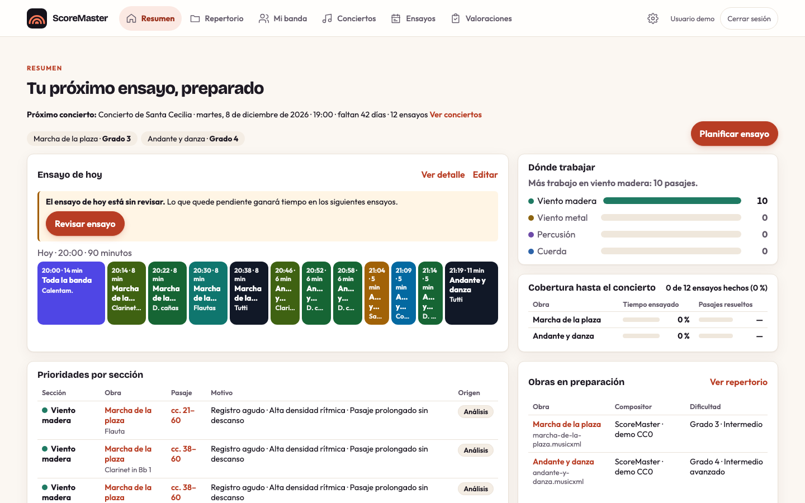
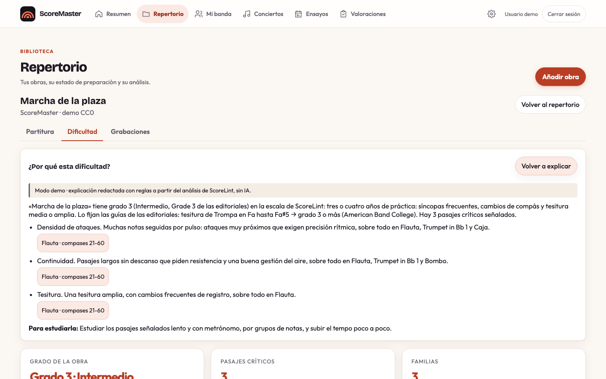
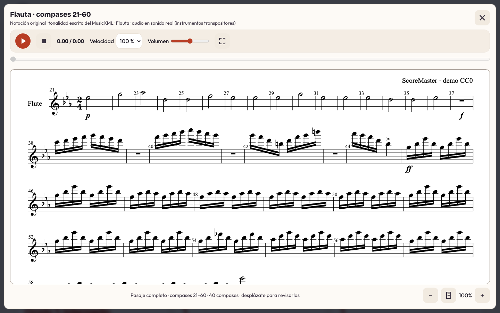
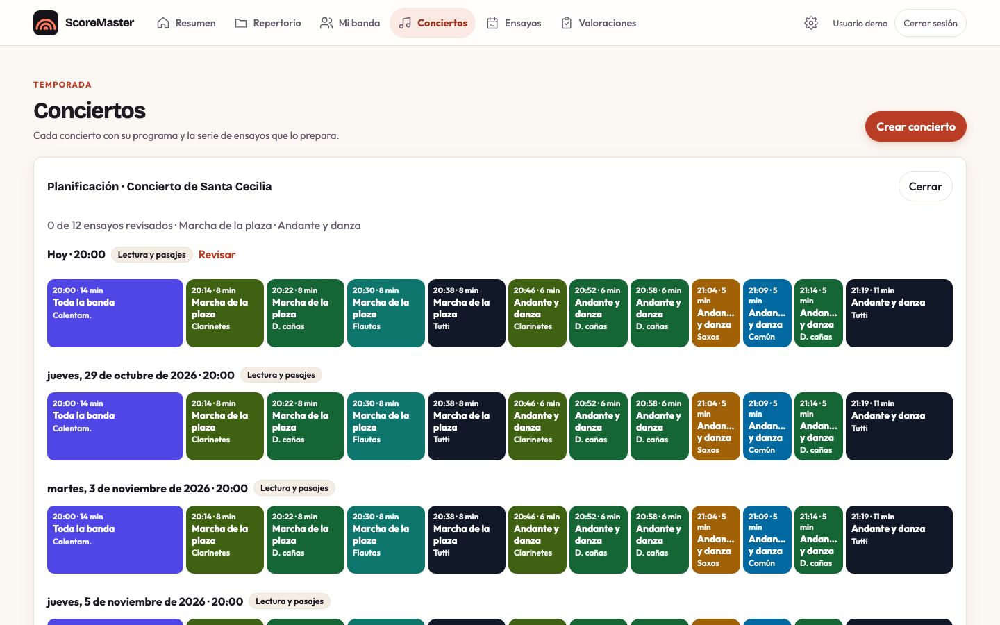
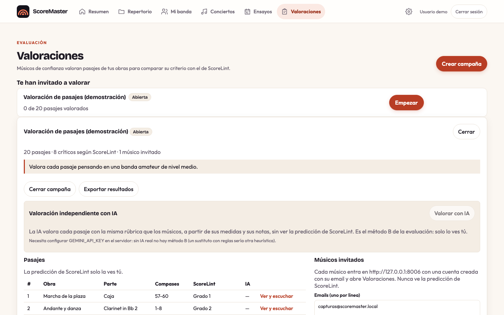
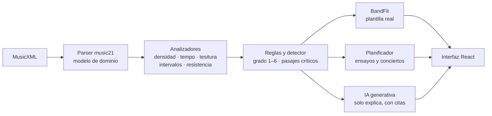

# ScoreMasterAI

Asistente para **directores de banda**. Analiza la dificultad de una partitura, comprueba si encaja con
la plantilla real de la banda y ayuda a planificar los ensayos hasta el concierto. La dificultad la
calcula un motor **determinista y reproducible** (ScoreLint); la IA generativa solo **explica** esos
resultados y nunca sustituye los datos musicales.

Trabajo Fin de Máster del Máster de Desarrollo con IA de BigSchool · Licencia [MIT](LICENSE).

**Demo publicada:** https://scoremaster-iz4j.onrender.com (plan gratuito de Render: el primer acceso puede
tardar alrededor de un minuto). La contraseña de la cuenta demo se entrega aparte; la
[guía para el tribunal](docs/TRIBUNAL.md) propone un recorrido de cinco minutos.



## Qué responde

La pantalla de cada obra responde a las tres preguntas del director:

1. **¿Qué dificultad tiene esta obra?** Grado 1–6 (alineado con la escala Grade 1–6 de las editoriales),
   por obra, familia e instrumento, con sus pasajes críticos y el motivo de cada uno.
2. **¿Encaja con mi banda?** Instrumentos que faltan, partes sin intérprete y necesidades de percusión,
   comparadas con la plantilla de la banda activa.
3. **¿Cómo debería ensayarla?** Una serie de ensayos hasta el concierto, con bloques por línea común,
   sección y tutti, que se replanifica tras revisar cada ensayo.

## Funcionalidades

| Área | Qué hace |
|---|---|
| **Repertorio** | Subida de MusicXML (`.musicxml`, `.xml` o `.mxl`), análisis de ScoreLint guardado por obra, estado de preparación, partitura completa con todas las voces y audio, búsqueda de grabaciones en YouTube y **grado publicado por las editoriales** registrado a mano para compararlo con ScoreLint |
| **Dificultad (ScoreLint)** | **Grado según las tablas de grados** (Federación Galega de Bandas de Música, American Band College y FJH): armadura, compás, tempo, duración, dinámicas y, por instrumento, tesitura, figuras, grupos irregulares, síncopas, articulaciones y adornos, con el criterio que fija el grado. Índice técnico con seis dimensiones (densidad rítmica, tempo, tesitura, registro, intervalos y resistencia), reglas SL002 registro agudo, SL003 alta densidad rítmica, SL004 intervalos amplios y SL005 pasaje prolongado sin descanso, y detector de **pasajes críticos** (puede no haber ninguno). Árbol de familia a instrumento y «Ver pasaje» con la notación y el audio de esa parte |
| **Mi banda (BandFit)** | Varias bandas por director con su plantilla por instrumento, nivel por sección y días de ensayo; adecuación de la obra abierta a la banda activa y confirmación humana de instrumentos dudosos |
| **Conciertos** | Programa, patrón semanal y propuesta de la serie de ensayos por fases (lectura y pasajes, integración y ensayo general); calendario mensual; en el Resumen, cobertura de la serie: ensayos hechos y, por obra, tiempo ensayado y pasajes resueltos |
| **Ensayos** | Agenda por bloques editable con varias obras; revisión bloque a bloque (resuelto, mejorable, pendiente) que alimenta las prioridades del Resumen |
| **IA explicativa** | «¿Por qué esta dificultad?» y «¿Por qué este plan?» redactadas por **Gemini** a partir de las evidencias del análisis, con citas comprobadas; sin clave responde un **modo demo identificado** como tal |
| **Valoraciones** | Campañas en las que músicos invitados valoran pasajes (grado, criticidad y prioridad) sin ver la predicción ni las valoraciones de los demás; solo una cuenta administradora las crea y ve los resultados; valoración independiente con IA (método B); exportación anónima e informe reproducible |
| **Configuración** | Nombre visible, tamaño del texto y **tema claro, oscuro o automático** |

<table>
<tr><td></td>
<td></td></tr>
<tr><td></td>
<td></td></tr>
</table>

## Arquitectura

El principio del proyecto es **datos → algoritmos → reglas → IA generativa**:



- **Dominio y motores sin dependencias externas** (`backend/domain`, `backend/analyzers`, `backend/rules`):
  el mismo archivo produce siempre el mismo análisis.
- **Aplicación con puertos** (`backend/application`): repositorios y proveedor de IA son interfaces; la
  infraestructura (`backend/infrastructure`) los implementa con PostgreSQL y con Gemini o la demo.
- **La IA nunca es fuente de verdad**: recibe evidencias acotadas (grados, dimensiones, compases, bloques),
  responde con un esquema validado por Pydantic y cada pasaje o bloque que cita se comprueba contra las
  evidencias. Ante cualquier fallo responde la demo y la interfaz dice por qué.
- **Cada obra se lee una sola vez**: music21 es lento con una partitura de banda (minutos en el plan
  gratuito), así que el modelo leído y la línea de tiempo del audio se guardan por el hash del archivo.

Detalles: [dificultad y criticidad](docs/DIFFICULTY_CRITICALITY.md), [identidad de instrumentos](docs/INSTRUMENT_RESOLUTION.md),
[capa de IA](docs/LLM_LANGCHAIN_ARCHITECTURE.md), [visor de partituras](docs/SCORE_VIEWER.md),
[audio](docs/REALISTIC_AUDIO.md) y [plan aprobado con su estado](docs/IMPLEMENTATION_ROADMAP.md).

## Stack

| Capa | Tecnología |
|---|---|
| Backend | Python 3.12, FastAPI 0.143, Pydantic, music21 8.3, SQLAlchemy 2 y Alembic |
| Base de datos | PostgreSQL 17 |
| IA | Google Gemini mediante LangChain (`langchain-google-genai` 4.4), opcional; modo demo determinista |
| Frontend | React 19 y Vite 8, CSS propio con tokens (tema claro y oscuro), OpenSheetMusicDisplay 1.9 para la notación y smplr 1.1 para el audio |
| Calidad | pytest (con PostgreSQL real), pruebas de Node, recorridos Playwright, **auditoría de accesibilidad WCAG 2.1 A y AA con axe-core** en todas las pantallas (claro, oscuro y móvil) y auditoría de dependencias en GitHub Actions |
| Despliegue | Docker y Docker Compose; Render (Blueprint `render.yaml`) con la base en Neon |

## Arranque en un paso

Con Docker:

```sh
git clone https://github.com/monicamorenogomez76/scoremaster-ai.git
cd scoremaster-ai
cp .env.example .env
docker compose up --build
```

Abre http://127.0.0.1:8000. El contenedor aplica las migraciones y crea la cuenta demo **con contenido**:
tres obras originales ya analizadas, una banda, un concierto con su serie de ensayos y una campaña de
valoración abierta a la que está invitada (la demo no es administradora: valora como un músico).

| Usuario de prueba (solo en local) | Contraseña |
|---|---|
| `demo@scoremaster.local` | `scoremaster-demo` |

También se puede crear una cuenta desde la pantalla de acceso. «Entrar con Google» solo aparece si
`GOOGLE_CLIENT_ID` y `GOOGLE_CLIENT_SECRET` están configurados.

Para enseñar el recorrido completo, [`demo/para-subir/pasodoble-de-las-fiestas.mxl`](demo/para-subir/pasodoble-de-las-fiestas.mxl)
no está precargada: se sube desde Repertorio → «Añadir obra».

### Desarrollo sin Docker

Python 3.12 y Node 20.19 o superior, con la base de Compose:

```sh
docker compose up -d db
python3.12 -m venv .venv && .venv/bin/pip install -r requirements.txt
npm --prefix frontend ci && npm --prefix frontend run build
set -a; . ./.env; set +a
.venv/bin/python -m alembic upgrade head
.venv/bin/python -m backend.app.seed_demo
.venv/bin/python -m uvicorn backend.app.main:app --reload
```

`npm --prefix frontend run watch` recompila el frontend al guardar.

## Configuración

Todas las claves son **opcionales**: sin ellas la aplicación funciona y desactiva limpiamente lo que
dependa de ellas.

| Variable | Para qué | Sin ella |
|---|---|---|
| `GEMINI_API_KEY` | Explicaciones y valoración independiente con Gemini ([crear clave](https://aistudio.google.com/apikey)) | Responde el modo demo, siempre identificado como «Modo demo · sin IA» |
| `GEMINI_MODEL`, `GEMINI_REVIEW_MODEL` | Modelo de las explicaciones (por defecto `gemini-3.8-flash`) y, si se quiere, otro con más cupo para «Valorar con IA» | Se usa el modelo por defecto |
| `GEMINI_REQUESTS_PER_MINUTE`, `GEMINI_TIMEOUT_SECONDS` | Pausa entre peticiones (5 por minuto) y tiempo máximo de respuesta (60 s) | Valores por defecto |
| `YOUTUBE_API_KEY` | Búsqueda de grabaciones dentro de la aplicación (la usa el servidor, nunca el navegador) | Enlace a la búsqueda en YouTube y opción de pegar un enlace |
| `GOOGLE_CLIENT_ID`, `GOOGLE_CLIENT_SECRET`, `GOOGLE_REDIRECT_URI` | «Entrar con Google» | Solo email y contraseña |
| `DEMO_USER_EMAIL`, `DEMO_USER_PASSWORD`, `DEMO_SEED_CONTENT` | Cuenta demo y su contenido de ejemplo (`1`) | Sin cuenta demo |
| `ADMIN_EMAILS` | Cuentas administradoras, separadas por comas: crean y gestionan campañas de valoración y ven los emails y resultados de los músicos. Registrar antes la cuenta (el registro no verifica el email) | Nadie puede crear campañas; cada cuenta solo valora las campañas a las que la invitan |
| `APP_ENV=production` | Cookies `Secure`, HSTS y sin documentación interactiva de la API | Modo desarrollo |

A la IA solo llegan datos derivados del análisis (grados, dimensiones, compases, bloques), nunca la
partitura, emails ni nombres. Las respuestas válidas se guardan para no gastar cupo dos veces.

## Evaluación experimental

La pregunta del TFM: ¿puede un sistema híbrido de análisis determinista e IA generativa asistir a un
director en la evaluación de la dificultad, la adecuación del repertorio y la planificación del ensayo?

| Método | Qué es |
|---|---|
| **A · ScoreLint** | La predicción guardada al crear la campaña |
| **B · LLM** | Gemini valora cada pasaje con la misma rúbrica, a partir de sus medidas, **sin ver la predicción de ScoreLint** |
| **C · Híbrido** | Regla **preregistrada el 2026-10-13**, antes de recibir valoraciones: media de A y B; crítico solo si los dos coinciden |
| **D · Músicos** | La referencia: mediana de sus grados y criticidad por mayoría |

Los músicos invitados valoran desde su propia cuenta. La exportación es anónima y el informe se genera
siempre igual desde ella, con MAE, Spearman, precisión, recall, F0.5, acuerdo entre evaluadores, la
comparación de los métodos sobre los mismos pasajes y el grado de cada obra frente al de las editoriales:

```sh
python -m evaluation.campaign_report exportacion.json --markdown informe.md
```

Protocolo y métricas en [evaluation/README.md](evaluation/README.md) y
[docs/EVALUATION_AND_FEEDBACK.md](docs/EVALUATION_AND_FEEDBACK.md). `python -m evaluation.baseline`
comprueba que el comportamiento heredado sigue siendo el capturado.

## Pruebas e integración continua

```sh
export TEST_DATABASE_URL=$(grep ^DATABASE_URL .env | cut -d= -f2-)
.venv/bin/python -m pytest -q backend/test        # unas 720 pruebas, con PostgreSQL real
node --test backend/test/frontend/*.test.mjs       # módulos del frontend
```

Los recorridos de navegador (`backend/test/frontend/*.e2e.mjs`) se ejecutan con Playwright contra un
servidor real. GitHub Actions ([ci.yml](.github/workflows/ci.yml)) los lanza en cada pull request junto con
pytest, las pruebas de Node, la construcción de la imagen Docker y la auditoría de dependencias
(`pip-audit`, `npm audit`). El desarrollo sigue TDD: cada cambio empieza con una prueba que falla.

## Despliegue

Render con la misma imagen Docker y la base en el PostgreSQL gratuito de Neon, que no caduca:
[docs/DEPLOYMENT.md](docs/DEPLOYMENT.md), con los pasos, el paso de los datos a Neon, las limitaciones del plan
gratuito, los scripts probados de copia y restauración y por qué Vercel queda para más adelante.

## Seguridad

Diseñada con OWASP desde el principio: contraseñas Argon2id, sesiones en servidor con CSRF, autorización
por objeto (una obra ajena responde 404), límites de subida, CSP y cabeceras, HSTS en producción,
auditoría de dependencias y medidas del OWASP LLM Top 10 para la capa de IA. Detalle de lo aplicado y lo
pendiente en [docs/SECURITY.md](docs/SECURITY.md).

## Estructura del repositorio

```text
backend/
  domain/          modelo musical, catálogo de instrumentos y escala de grados
  parsers/         MusicXML → modelo (music21), audio y caché de obras leídas
  analyzers/       dificultad, pasajes críticos, BandFit, ensayos y conciertos
  rules/           reglas de ScoreLint
  application/     casos de uso y puertos (repositorios, IA)
  infrastructure/  PostgreSQL y proveedores de IA (Gemini y demo)
  app/             API FastAPI, seguridad y semilla de la demo
  test/            pruebas Python, de Node y recorridos Playwright
frontend/          React + Vite (se compila en backend/app/static/frontend)
migrations/        migraciones Alembic
evaluation/        baseline e informe de las campañas
demo/              obras originales CC0 de la demo y la obra para subir en directo
scripts/           generador de las obras de la demo y copia de la base
docs/              especificaciones, guías y decisiones
```

Las pautas de trabajo están en [CONTRIBUTING.md](CONTRIBUTING.md); [AGENTS.md](AGENTS.md) y
[CLAUDE.md](CLAUDE.md) orientan al asistente de IA usado durante el desarrollo.

## Limitaciones conocidas

- **ScoreLint no está validado todavía con músicos**: desde difficulty-v4 el grado sigue la tabla de la
  Federación Galega de Bandas de Música, con el American Band College y FJH donde esta no llega, y *Persis*
  coincide con el Grade 4 de su editorial, pero
  algunos umbrales (cambios de compás, uso limitado) son una lectura de esas guías y solo hay una obra cuyo
  archivo coincide con la edición que publica el grado; la evaluación con músicos debe medir cuánto se desvía.
- **Articulación solo para el grado**: las articulaciones, dinámicas y adornos se leen para el grado, pero aún no generan reglas ni pasajes críticos.
- **Audio aproximado**: muestras reales para los instrumentos principales y General MIDI para el resto,
  sin expresión ni repeticiones. Si en Safari avanza el tiempo pero no se oye nada, cerrar Safari con ⌘Q y
  volver a abrirlo suele resolverlo.
- **Plan gratuito de Render**: el servicio se duerme sin uso y la CPU es lenta (una obra grande tarda unos
  minutos en leerse la primera vez). La base de Neon se suspende tras 5 minutos sin uso y despierta sola.
- **Solo MusicXML**: sin PDF ni reconocimiento óptico; la interfaz está en castellano.
- **Pendiente u opcional**: pregunta libre a la IA, interfaz en inglés, sustitutos de instrumento,
  búsqueda automática del grado publicado de una obra, segunda opinión con un modelo de pesos abiertos e
  importación de PDF (prueba con copista-2m, un modelo abierto de Hugging Face, solo en local).

## Créditos

- **Notación**: [OpenSheetMusicDisplay](https://opensheetmusicdisplay.org/) (BSD-3-Clause).
- **Audio**: [smplr](https://github.com/danigb/smplr) (MIT) con grabaciones de
  [tonejs-instruments](https://github.com/nbrosowsky/tonejs-instruments) (VSCO 2 Community Edition y
  Karoryfer Samples, CC0; University of Iowa, sin restricciones) y la fuente General MIDI MusyngKite de
  [midi-js-soundfonts](https://github.com/gleitz/midi-js-soundfonts) (CC BY-SA 3.0). Se descargan de sus
  CDN durante la reproducción; no se incluyen en el repositorio.
- **Tipografía**: Bricolage Grotesque y Outfit (SIL Open Font License), incluidas en el build con `@fontsource-variable`.
- **Obras de la demo**: composiciones originales de este repositorio, CC0 ([demo/LICENSES.md](demo/LICENSES.md)).
